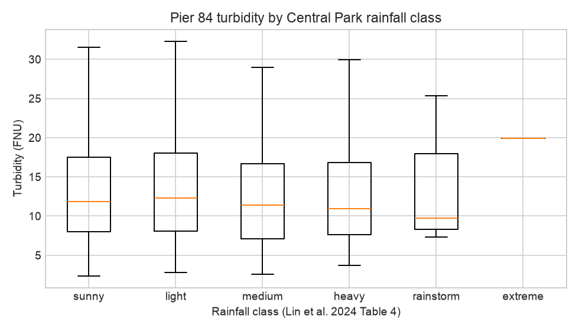
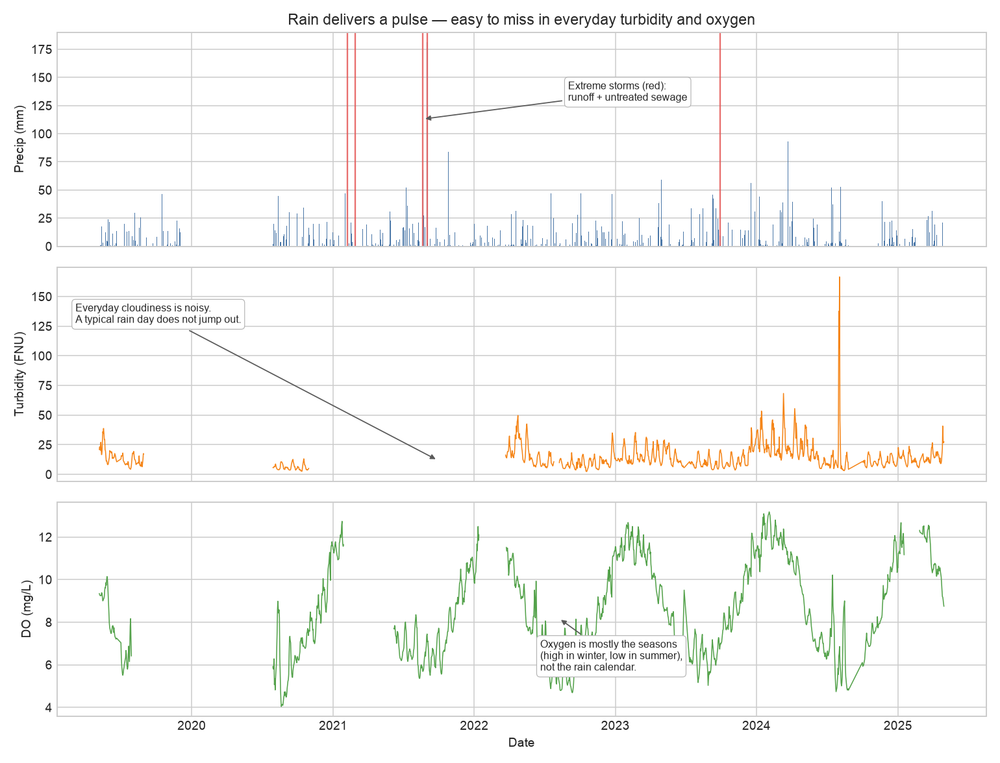

# Rainfall–water quality models (Hudson River Park)

Analytical models that link **extreme rainfall and combined-sewer overflow (CSO)** to **receiving-water quality**, starting at Hudson River Park and designed to extend across New York Harbor.

This repository is a first baseline: public data, event classification from Lin et al. (2024), skill scores (R², NSE), and a reduced-form rain → water-quality transfer function. A full SWMM–EFDC land–river coupling is formulated for later work once pipe-network and bathymetry layers are available.

## Study site

**USGS 01376515 — Hudson River at Pier 84, New York, NY** sits on the left bank in Hudson River Park (40.765°N, 74.003°W), about 4 miles upstream of the mouth. A multi-parameter sonde records water temperature, specific conductance, pH, dissolved oxygen, and turbidity every 15 minutes (May 2019–April 2025 in the current pull). Salinity is not published as a separate instantaneous series here; specific conductance is the mixing proxy.

NYC DEP Harbor Survey stations on the same Hudson transect:

| Station | Location | Role |
| --- | --- | --- |
| N4 | W. 42nd Street | Mid-park; fecal coliform, enterococci, nutrients, TSS |
| N5 | Pier A / The Battery | South end of the park |
| N3B | W. 125th Street | Next upstream Inner Harbor station |

The USGS sonde **does not measure rainfall**. Precipitation is taken from NOAA Central Park (closest long-record Manhattan gauge, ~2.5 km from Pier 84) and from hourly ASOS at Central Park (KNYC) and LaGuardia (KLGA).

## Data sources

| Layer | Source | Access | What we use |
| --- | --- | --- | --- |
| Continuous WQ | [USGS 01376515](https://waterdata.usgs.gov/monitoring-location/USGS-01376515/) | NWIS IV/DV, no token | 15-min sonde, aggregated to daily |
| Daily rain | NOAA / NWS Central Park `USW00094728` | [ACIS StnData](https://data.rcc-acis.org/StnData), no token | Daily precip (in/mm), Tmax/Tmin |
| Hourly rain | IEM ASOS `NYC`, `LGA` | [IEM ASOS](https://mesonet.agron.iastate.edu/request/download.phtml) | Sub-daily timing of storms |
| Pathogens / nutrients | [NYC Harbor Water Quality](https://data.cityofnewyork.us/Environment/Harbor-Water-Quality/5uug-f49n) | Socrata `5uug-f49n` | N3B, N4, N5 grab samples |

**Not used yet (next CSO-physical step):** NYC DEP rain-gauge network, NEXRAD/MRMS Stage IV grids, DEP CSO outfall GIS / LTCP event files, HRECOS (Pier 84 operations moved off USGS after spring 2025).

Raw downloads stay local (`data/raw/`, gitignored). Re-fetch with:

```bash
python3 -m venv .venv
source .venv/bin/activate
pip install -r requirements.txt
python scripts/fetch_all.py          # add --skip-iv to skip 15-minute USGS
python scripts/run_baseline.py
```

## Mathematical model

The reference paper is stored **only on this machine** at `paper/ref/lin-2024-swmm-efdc-pollutant-dispersion.pdf` (gitignored; see `paper/README.md`). The formulation used here is written out in [`docs/model_formulation.md`](docs/model_formulation.md).

Short version:

1. **Physical target (paper):** SWMM (land + pipes) supplies CSO/runoff boundaries to EFDC (river transport). Lateral mixing \(E_z=\alpha h u_x\). Skill: R² and Nash–Sutcliffe (NSE).
2. **Rainfall classes (paper Table 4, mm/day):** sunny 0; light 0.1–9.9; medium 10–24.9; heavy 25–49.9; rainstorm 50–99.9. NYC CSO activation is flagged at **0.10 in (~2.5 mm)**.
3. **Baseline implemented now:** exponential impulse response of daily rain on Pier 84 water quality, plus a seasonal cycle, plus conductance as a tide/mixing covariate:

\[
Y_t=\beta_0+\beta_r K_\tau(P)_t+\gamma_1\sin(2\pi t/365.25)+\gamma_2\cos(2\pi t/365.25)+\delta S_t+\varepsilon_t
\]

\(\tau\) is chosen by validation NSE. This is the same *information flow* as SWMM→EFDC with both ends replaced by measurements.

## Baseline results (2019-05-07 to 2025-04-30)

Aligned record: **1,881 days**, 664 wet days (\(P\ge0.1\) mm).

### Rain-class water quality at Pier 84

Daily-mean turbidity is not a clean linear function of daily rain (tides dominate). Extreme rain days still stand out:

| Class | Days | Median turbidity (FNU) | Median DO (mg/L) |
| --- | ---: | ---: | ---: |
| Sunny | 1217 | 11.8 | 8.12 |
| Light | 435 | 12.3 | 8.80 |
| Medium | 164 | 11.4 | 7.88 |
| Heavy | 49 | 10.9 | 8.34 |
| Rainstorm | 11 | 9.8 | 7.71 |
| Extreme (≥100 mm) | 5 | **19.9** | **6.91** |



### Transfer-function skill (last 20% hold-out)

| Target | Model | Validation R² | Validation NSE |
| --- | --- | ---: | ---: |
| Turbidity | rain kernel + season + conductance | 0.00 | −0.10 |
| Turbidity | season only | 0.00 | −0.19 |
| Dissolved oxygen | rain kernel + season + conductance | **0.88** | **0.87** |
| Dissolved oxygen | season only | 0.85 | 0.84 |

DO is mostly the annual cycle; rainfall adds a small increment (NSE 0.84 → 0.87). Daily-mean turbidity is not predictable from Central Park daily rain at this tidal site. That is expected: CSO pulses last hours, and the Hudson at Pier 84 is a well-mixed estuary.



### Harbor Survey pathogens (N4 / N5) — the CSO signature

Grab-sample **enterococci** and **fecal coliform** at the park stations rise with rainfall class (same-day Central Park rain). This is the sewage indicator the sonde does not measure.

| Station | Sunny entero / fecal | Medium | Heavy |
| --- | --- | --- | --- |
| N4 (W. 42nd) | 7 / 51 | 33 / 125 | **50 / 204** |
| N5 (Battery) | 5 / 44 | 21 / 140 | **26 / 104** |

Medians, cells/100 mL; sample sizes are small on heavy days (n = 5).

## Repository layout

```
scripts/fetch_usgs.py       # USGS Pier 84 daily + 15-minute
scripts/fetch_rainfall.py   # ACIS Central Park + IEM hourly
scripts/fetch_harbor.py     # DEP Harbor Survey N3B/N4/N5
scripts/fetch_all.py
scripts/run_baseline.py     # events, transfer function, figures
src/rainfall_wq/            # site config, Lin et al. skill scores
docs/model_formulation.md
paper/README.md             # local PDF only; not in this git repo
data/raw/                   # gitignored downloads
data/sample/                # small committed excerpts
outputs/                    # baseline figures
```

## Next steps

1. Tide-harmonic residuals so the rain kernel is not competing with M2.
2. Event-based first flush on 15-minute turbidity using hourly KNYC rain.
3. DEP CSO outfall GIS + LTCP overflow events as a binary covariate.
4. SWMM of west-side combined districts; EFDC or a 1-D estuary box as the receiving model (Lin et al. architecture).
5. Expand beyond Hudson River Park using Harbor Survey Inner Harbor stations (N1, N3B, N6, …).

## Collaboration

Code is at [aliarb/rainfall-water-quality](https://github.com/aliarb/rainfall-water-quality). Clone, recreate the environment, and pull public data on your machine. Do not commit `paper/ref/` PDFs or `data/raw/` downloads; both are gitignored.

```bash
git clone https://github.com/aliarb/rainfall-water-quality.git
cd rainfall-water-quality
python3 -m venv .venv
source .venv/bin/activate
pip install -r requirements.txt
python scripts/fetch_all.py
python scripts/run_baseline.py
```

The Lin et al. (2024) PDF is local-only. Use the DOI in `paper/README.md` if you need the source paper; the equations used here are in [`docs/model_formulation.md`](docs/model_formulation.md).

Work on a branch off `main`, keep commits focused, and open a pull request. Before you push, run `git status` and confirm no PDFs or raw data files are staged. Regenerated figures under `outputs/` may be included when they change the reported baseline.
