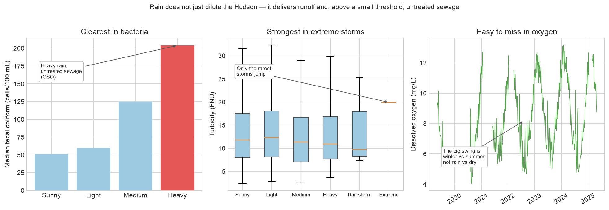
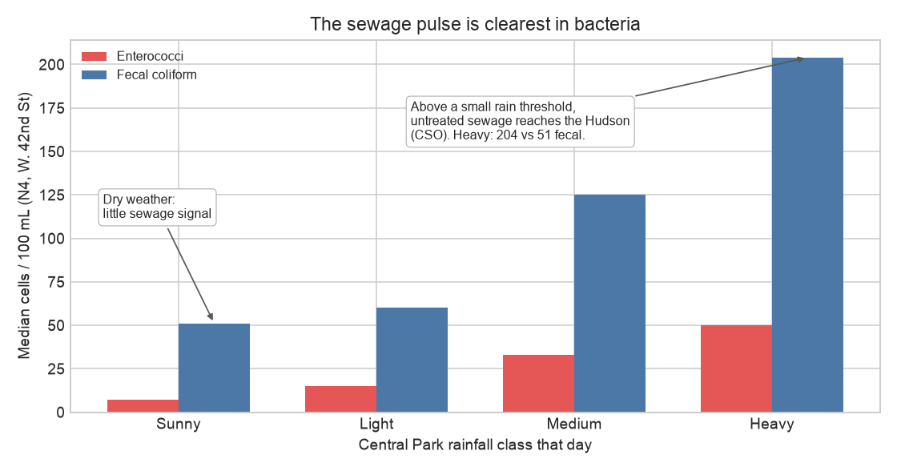
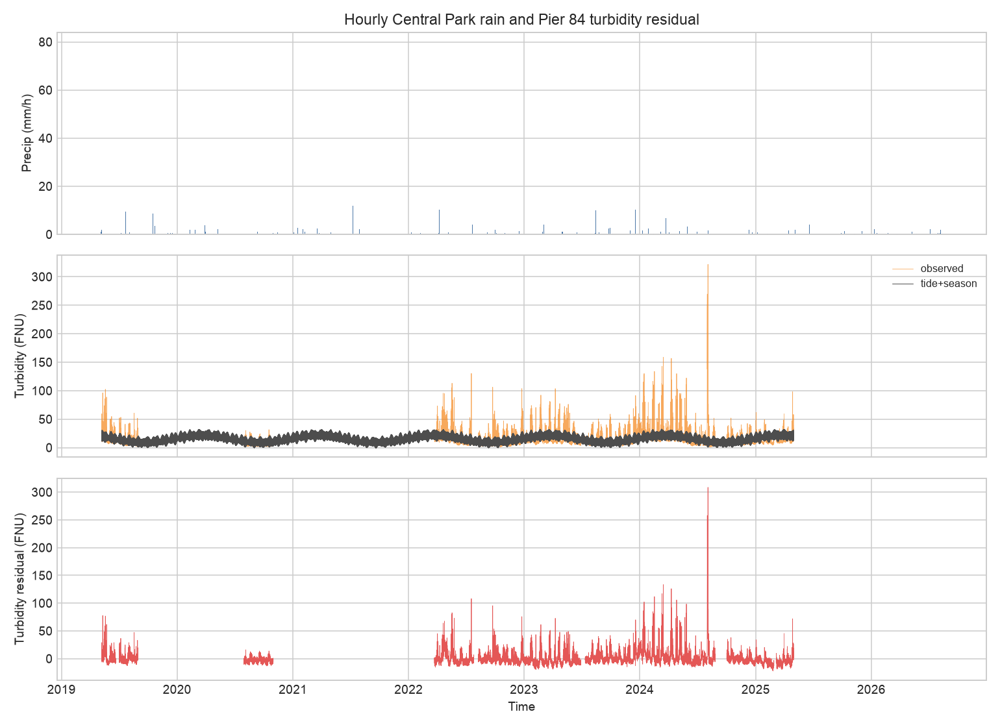
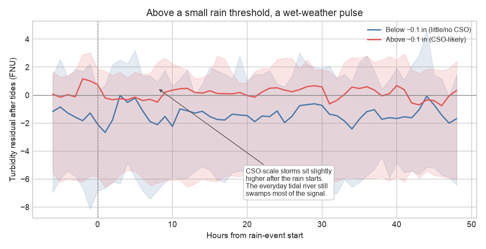
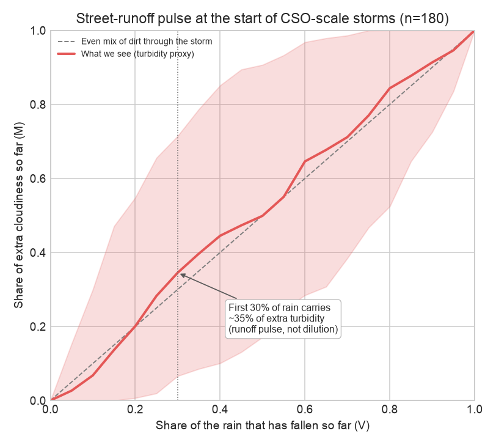
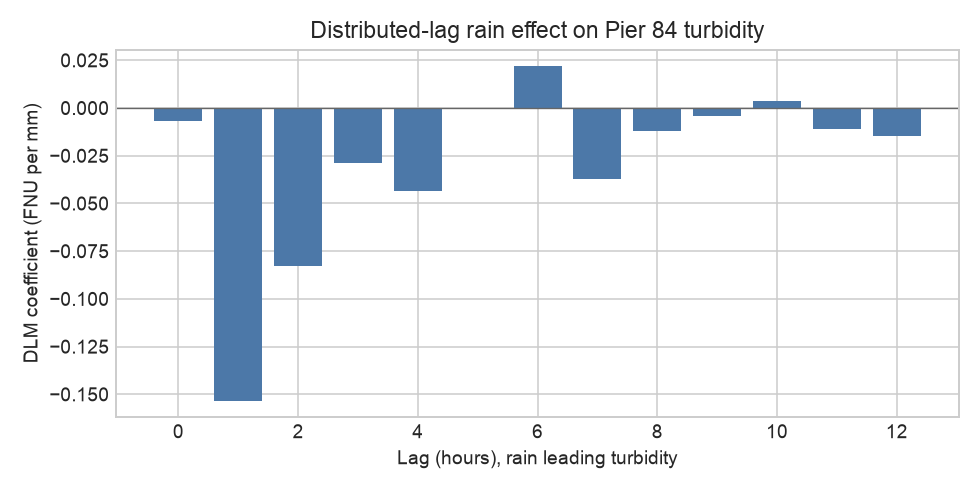
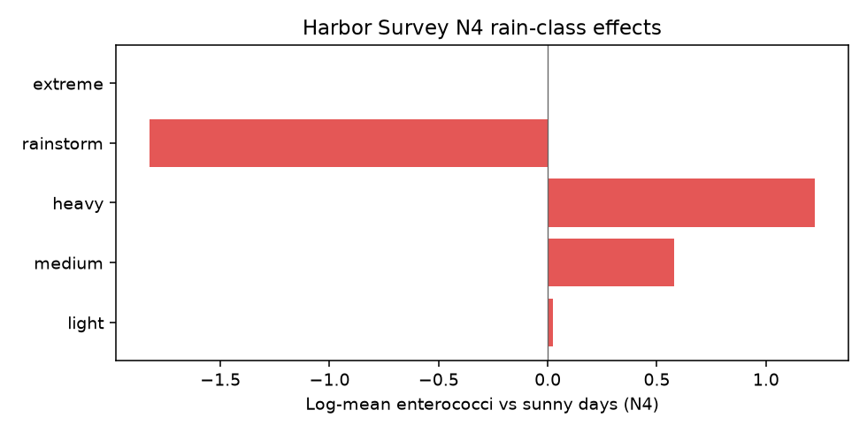

# Rainfall–water quality models (Hudson River Park)

Analytical models that link **extreme rainfall and combined-sewer overflow (CSO)** to **receiving-water quality**, starting at Hudson River Park and designed to extend across New York Harbor.

This repository is a first baseline: public data, event classification from Lin et al. (2024), skill scores (R², NSE), and a reduced-form rain → water-quality transfer function. A full SWMM–EFDC land–river coupling is formulated for later work once pipe-network and bathymetry layers are available.

## In short

Rain does not just dilute the Hudson. It delivers a pulse of street runoff and, above a small threshold, untreated sewage. That pulse is clearest in bacteria and in a short oxygen dip after storms, it arrives a day or two before the river freshens, and it is easy to miss if you only watch the tidal river’s everyday turbidity and oxygen.



- **Bacteria (left):** at Hudson River Park (N4, W. 42nd St), median fecal coliform rises from 51 cells/100 mL on sunny days to **204** on heavy-rain days — untreated sewage from combined-sewer overflow.
- **Extreme storms (middle):** everyday turbidity barely changes from sunny through rainstorm. Only three days reached ≥100 mm, and the sonde recorded turbidity on just one of them (29 Sep 2023, 19.9 FNU), so the extreme class is not a trend.
- **Oxygen (right):** the big swing is winter vs summer, not rain vs dry.

Callouts on the turbidity boxplot, rainfall time series (red = extreme storms), and oxygen panel mark the same points.

## Study site

**USGS 01376515 — Hudson River at Pier 84, New York, NY** sits on the left bank in Hudson River Park (40.765°N, 74.003°W), about 4 miles upstream of the mouth. A multi-parameter sonde records water temperature, specific conductance, pH, dissolved oxygen, and turbidity every 15 minutes (May 2019–April 2025 in the current pull). Salinity is not published as a separate instantaneous series here; specific conductance is the mixing proxy.

NYC DEP Harbor Survey stations on the same Hudson transect:

| Station | Location | Role |
| --- | --- | --- |
| N4 | W. 42nd Street | Mid-park; fecal coliform, enterococci, nutrients, TSS |
| N5 | Pier A / The Battery | South end of the park |
| N3B | W. 125th Street | Next upstream Inner Harbor station |

The USGS sonde **does not measure rainfall**. Precipitation is taken from NOAA Central Park (closest long-record Manhattan gauge, ~2.5 km from Pier 84) and from hourly ASOS at Central Park (KNYC) and LaGuardia (KLGA).

## Data sources

| Layer | Source | Access | What we use |
| --- | --- | --- | --- |
| Continuous WQ | [USGS 01376515](https://waterdata.usgs.gov/monitoring-location/USGS-01376515/) | NWIS IV/DV, no token | 15-min sonde, aggregated to daily |
| Daily rain | NOAA / NWS Central Park `USW00094728` | [ACIS StnData](https://data.rcc-acis.org/StnData), no token | Daily precip (in/mm), Tmax/Tmin |
| Hourly rain | IEM ASOS `NYC`, `LGA` | [IEM ASOS](https://mesonet.agron.iastate.edu/request/download.phtml) | Sub-daily timing of storms |
| Pathogens / nutrients | [NYC Harbor Water Quality](https://data.cityofnewyork.us/Environment/Harbor-Water-Quality/5uug-f49n) | Socrata `5uug-f49n` | N3B, N4, N5 grab samples |
| Water colour | [Sentinel-2 L2A](https://planetarycomputer.microsoft.com/dataset/sentinel-2-l2a) | Planetary Computer STAC, no token | NDTI, hue / Forel-Ule, Nechad turbidity proxy, NDCI in a mid-channel box west of Pier 84 |

**Not used yet (next CSO-physical step):** NYC DEP rain-gauge network, NEXRAD/MRMS Stage IV grids, DEP CSO outfall GIS / LTCP event files, HRECOS (Pier 84 operations moved off USGS after spring 2025).

Raw downloads stay local (`data/raw/`, gitignored). Re-fetch with:

```bash
python3 -m venv .venv
source .venv/bin/activate
pip install -r requirements.txt
python scripts/fetch_all.py          # add --skip-iv to skip 15-minute USGS; --skip-rs to skip Sentinel-2
python scripts/run_baseline.py      # daily rain-class baseline
python scripts/run_wave1.py         # tides, storms, DLM/GAM, N4/N5 bacteria
python scripts/run_remote_sensing.py  # Sentinel-2 colour vs rain class and USGS turbidity
python scripts/run_class_response.py  # hypothesis tests: storm response by rain class vs placebo, N3B/N4/N5 bacteria
python scripts/plot_annotated.py    # plain-language callouts on the figures
```

## Mathematical model

The reference paper is stored **only on this machine** at `paper/ref/lin-2024-swmm-efdc-pollutant-dispersion.pdf` (gitignored; see `paper/README.md`). The formulation used here is written out in [`docs/model_formulation.md`](docs/model_formulation.md).

Short version:

1. **Physical target (paper):** SWMM (land + pipes) supplies CSO/runoff boundaries to EFDC (river transport). Lateral mixing \(E_z=\alpha h u_x\). Skill: R² and Nash–Sutcliffe (NSE).
2. **Rainfall classes (paper Table 4, mm/day):** sunny 0; light 0.1–9.9; medium 10–24.9; heavy 25–49.9; rainstorm 50–99.9. NYC CSO activation is flagged at **0.10 in (~2.5 mm)**.
3. **Baseline implemented now:** exponential impulse response of daily rain on Pier 84 water quality, plus a seasonal cycle, plus conductance as a tide/mixing covariate:

\[
Y_t=\beta_0+\beta_r K_\tau(P)_t+\gamma_1\sin(2\pi t/365.25)+\gamma_2\cos(2\pi t/365.25)+\delta S_t+\varepsilon_t
\]

\(\tau\) is chosen by validation NSE. This is the same *information flow* as SWMM→EFDC with both ends replaced by measurements.

## Baseline results (2019-05-07 to 2025-04-30)

Aligned record: **1,881 days**, 664 wet days (\(P\ge0.1\) mm).

### Rain-class water quality at Pier 84

Daily-mean turbidity is not a clean linear function of daily rain (tides dominate). Classes are half-open, so a 0.39 in (9.906 mm) day is light, not extreme. Only three days reached the extreme class (21 Aug 2021, 1 Sep 2021, 29 Sep 2023), and turbidity was missing on the two 2021 days:

| Class | Days | Median turbidity (FNU) | Median DO (mg/L) |
| --- | ---: | ---: | ---: |
| Sunny | 1217 | 11.8 | 8.12 |
| Light | 437 | 12.3 | 8.80 |
| Medium | 164 | 11.4 | 7.88 |
| Heavy | 49 | 10.9 | 8.34 |
| Rainstorm | 11 | 9.8 | 7.71 |
| Extreme (≥100 mm) | 3 | 19.9 (1 day) | 6.91 |

Rainstorm and extreme days are also the warmest (median water temperature 23.5 and 24.9 °C against 15.2 °C on sunny days), so their low DO is partly seasonal. `run_class_response.py` removes an annual cycle and year offsets fitted on sunny days; after that, no class differs from sunny days in DO, and only light rain differs in turbidity (−0.83 FNU).


### Transfer-function skill (last 20% hold-out)

| Target | Model | Validation R² | Validation NSE |
| --- | --- | ---: | ---: |
| Turbidity | rain kernel + season + conductance | 0.00 | −0.10 |
| Turbidity | season only | 0.00 | −0.19 |
| Dissolved oxygen | rain kernel + season + conductance | **0.88** | **0.87** |
| Dissolved oxygen | season only | 0.85 | 0.84 |

DO is mostly the annual cycle; rainfall adds a small increment (NSE 0.84 → 0.87). Daily-mean turbidity is not predictable from Central Park daily rain at this tidal site. That is expected: CSO pulses last hours, and the Hudson at Pier 84 is a well-mixed estuary.


### Harbor Survey pathogens (N4 / N5) — the CSO signature

Grab-sample **enterococci** and **fecal coliform** at the park stations rise with rainfall class (same-day Central Park rain). This is the sewage indicator the sonde does not measure.

| Station | Sunny entero / fecal | Medium | Heavy |
| --- | --- | --- | --- |
| N4 (W. 42nd) | 7 / 51 | 33 / 125 | **50 / 204** |
| N5 (Battery) | 5 / 44 | 21 / 140 | **26 / 104** |

Medians, cells/100 mL; sample sizes are small on heavy days (n = 5).



## Wave 1–2: tides, storms, DLM/GAM, bacteria

Implemented in `scripts/run_wave1.py`. Harmonic periods are M2, S2, N2, K1, O1, M4, S1, Sa, Ssa. Equations are in [`docs/model_formulation.md`](docs/model_formulation.md).

Hourly overlap: **52,436 h** (2019-05-07 to 2025-04-30). **666** rain events (6 h inter-event dry time); **518** meet the 0.10 in CSO-proxy depth.

### What tides already explain

| Series | Harmonic R² (hourly) |
| --- | ---: |
| Dissolved oxygen | **0.88** |
| Specific conductance | 0.42 |
| Turbidity | 0.21 |



### Rain on top of tides

Adding a 0–12 h distributed lag or a spline GAM **does not beat** the harmonic baseline on a later-time hold-out. Turbidity validation NSE stays negative (~−0.12); DO validation NSE stays ~0.85 whether or not rain is included. After removing M2 and the annual cycle, hourly turbidity residuals still do not track Central Park rain in a linear or mildly nonlinear way.

| Target | Harmonic val NSE | DLM val NSE | GAM val NSE |
| --- | ---: | ---: | ---: |
| Turbidity | −0.12 | −0.12 | −0.13 |
| Dissolved oxygen | 0.85 | 0.85 | 0.85 |

A weak first-flush signal appears in residual turbidity: median \(M(V{=}0.3)=0.35\) (180 CSO-threshold events) versus 0.30 for uniform washoff. Hours with 24 h rain just above 2.54 mm have residual turbidity **0.85 FNU** higher than hours just below that threshold.





### Bacteria at N3B / N4 / N5 (the CSO tracer)

Negative-binomial GLM on Harbor Survey grabs overlapping the rain record (n ≈ 170 per station). Continuous 48 h rain is the specification that is identifiable; rain-class dummies are too sparse on heavy days for significant contrasts.

| Station / response | 48 h rain coef (log mean) | p-value | Intensity R² |
| --- | ---: | ---: | ---: |
| N3B fecal coliform | 0.032 | **<0.001** | 0.07 |
| N3B enterococci | 0.046 | 0.24 | 0.05 |
| N4 fecal coliform | 0.027 | **0.002** | 0.09 |
| N5 fecal coliform | 0.054 | **<0.001** | 0.33 |
| N5 enterococci | 0.048 | **0.037** | 0.31 |
| N4 enterococci | 0.042 | 0.27 | 0.11 |

At N5, each extra millimetre of rain in the prior 48 h multiplies expected fecal coliform by about \(e^{0.054}\approx 1.055\) (~5.5%). A 25 mm event is on the order of a **2×** increase. Point estimates for rain class at N4 enterococci rise from sunny → light → medium → heavy, but those class jumps are not significant given n = 5 heavy days.



**Takeaway:** learn *timing* from the sonde only after tides are removed — and even then rain is a weak turbidity driver. Learn *sewage severity* from N3B/N4/N5 bacteria, where 48 h rainfall is a significant predictor of fecal coliform at all three stations.

## Hypothesis tests by rain class

Implemented in `scripts/run_class_response.py`, which writes `event_response_by_class.csv`, `epoch_by_group.csv`, `bacteria_by_class_full.csv`, `bacteria_nb_all.csv`, `class_daily_anomaly.csv`, and `grab_analytes_rain_effect.csv` to `data/processed/`. Each storm is compared with dry placebo windows 7 days before and after at the same clock hour, so tidal and seasonal drift cancel.

- **Oxygen dips first.** Over the first 12 h, tide-removed DO fell by a median 0.077 mg/L after the 295 storms of at least 2.54 mm, against −0.005 in 335 placebo windows (p < 0.001). The dip bottoms 5–10 h after onset and recovers within a day. Storms below 2.54 mm show no dip.
- **The river freshens later.** Specific conductance does not change in the first 12 h but falls by 1,740 µS/cm 24–48 h after onset (placebo +630, p < 0.001), about 7% of its median.
- **Turbidity never separates from placebo** in any window or storm class.
- **Bacteria rise at all three stations.** Fecal coliform multiplies by 1.38 (N3B), 1.31 (N4), and 1.71 (N5) per 10 mm of 48 h rain, almost unchanged when an annual cycle is added. Routine sampling caught one or two rainstorm days per station and no extreme days.
- **Grab chemistry holds.** Salinity, ammonium, and suspended solids show no 48 h rain effect.

These are the H1–H5 results reported in `paper/main.tex`.

## Repository layout

```
scripts/fetch_usgs.py              # USGS Pier 84 daily + 15-minute
scripts/fetch_rainfall.py          # ACIS Central Park + IEM hourly
scripts/fetch_harbor.py            # DEP Harbor Survey N3B/N4/N5
scripts/fetch_remote_sensing.py    # Sentinel-2 L2A water colour (Planetary Computer)
scripts/fetch_all.py
scripts/run_baseline.py            # daily rain-class baseline
scripts/run_wave1.py               # harmonics, storms, DLM/GAM, bacteria GLM
scripts/run_remote_sensing.py      # satellite colour vs rain class and USGS turbidity
scripts/run_class_response.py      # hypothesis tests: storm vs placebo by class, bacteria, grabs
scripts/plot_annotated.py          # annotate figures with the plain-language finding
src/rainfall_wq/                   # tides, events, first flush, response, S2 indices
docs/model_formulation.md
paper/                      # Overleaf checkout of the manuscript; gitignored here
data/raw/                   # gitignored downloads
data/sample/                # small committed excerpts
outputs/                    # baseline figures
```

## Next steps

1. DEP CSO outfall GIS + LTCP overflow events as a binary treatment (regression discontinuity / classifier).
2. SWMM of west-side combined districts; EFDC or a 1-D estuary box as the receiving model (Lin et al. architecture).
3. Expand beyond Hudson River Park using Harbor Survey Inner Harbor stations (N1, N3B, N6, …).
4. Storm-targeted chemistry that the sonde and Harbor Survey do not measure: tire-wear 6PPD-quinone, microplastics, and petroleum hydrocarbons / PAHs (see `paper/main.tex` future-work section).

The *Urban Water Journal* manuscript is a separate Overleaf project, checked out at `paper/` and ignored by this repository: <https://git.overleaf.com/6ae4c4e1c27a05460bfd2fc1>. Edit and push it from that checkout. Do not copy it into this repository.

## Collaboration

Code is at [aliarb/rainfall-water-quality](https://github.com/aliarb/rainfall-water-quality). Clone, recreate the environment, and pull public data on your machine. Do not commit `data/raw/` downloads; that directory is gitignored. The manuscript is not part of this repository.

```bash
git clone https://github.com/aliarb/rainfall-water-quality.git
cd rainfall-water-quality
python3 -m venv .venv
source .venv/bin/activate
pip install -r requirements.txt
python scripts/fetch_all.py
python scripts/run_baseline.py
python scripts/run_wave1.py
python scripts/run_class_response.py
```

Work on a branch off `main`, keep commits focused, and open a pull request. Before you push, run `git status` and confirm no PDFs or raw data files are staged. Regenerated figures under `outputs/` may be included when they change the reported baseline.
